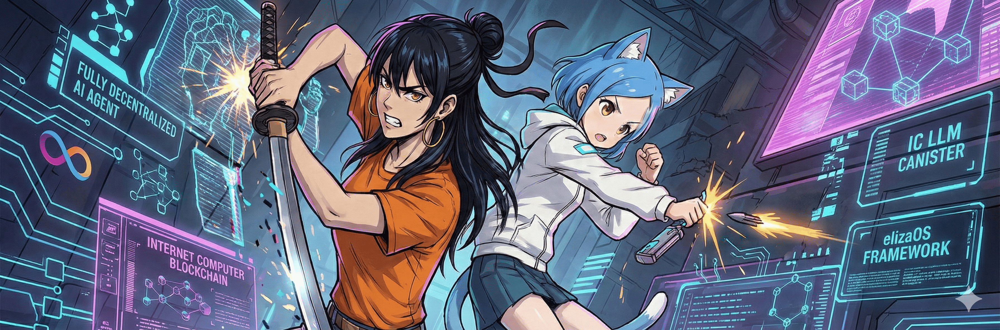

# Coo - Fully On-Chain AI Agent

<div align="center">
  
  <p>
    <strong>A fully decentralized AI agent running on the Internet Computer blockchain, powered by the elizaOS framework and IC LLM Canister (Llama 3.1 8B).</strong>
  </p>
</div>

## Live Demo

**Frontend:** https://4res3-liaaa-aaaas-qdqcq-cai.icp0.io/

**Backend Candid UI:** https://a4gq6-oaaaa-aaaab-qaa4q-cai.raw.icp0.io/?id=4wfup-gqaaa-aaaas-qdqca-cai

## Features

- **Fully On-Chain AI**: Uses IC LLM Canister (Llama 3.1 8B) for AI responses
- **Decentralized**: Runs entirely on Internet Computer blockchain
- **Censorship-Resistant**: No centralized servers or API dependencies
- **Internet Identity Authentication**: Secure user authentication
- **Conversation Memory**: Maintains context across conversations
- **Social Integration**: Twitter and Discord posting with auto-reply capabilities
- **ICP Wallet**: Native ICP wallet with balance checking and transfer capabilities
- **EVM Wallet**: Multi-chain EVM wallet via Chain-Key ECDSA (Base, Polygon, etc.)
- **Solana Wallet**: Ed25519-based Solana wallet with SOL and SPL token support
- **Cross-Chain DeFi**: Jupiter swap (Solana), Uniswap swap (EVM), LiFi bridge
- **Portfolio Analysis**: Unified view of assets across all chains
- **ERC-8004 Trustless Agents**: On-chain identity, reputation, and validation
- **Governance Integration**: Unified command execution with whitelist, audit trails, and admin management
- **elizaOS Framework**: Built on the leading open-source AI agent framework

## Architecture

```
┌─────────────────────────────────────────────────────────────────┐
│                     Internet Computer Mainnet                    │
│                                                                  │
│  ┌─────────────────┐    ┌──────────────────────────────────┐   │
│  │    Frontend     │    │        Backend Canister          │   │
│  │    Canister     │◄──►│      (Rust + ic-llm)            │   │
│  │    (React)      │    │                                  │   │
│  │                 │    │  ┌────────────────────────────┐  │   │
│  │ 4res3-liaaa-... │    │  │   IC LLM Canister          │  │   │
│  └─────────────────┘    │  │   (Llama 3.1 8B)           │  │   │
│                         │  └────────────────────────────┘  │   │
│  ┌─────────────────┐    │                                  │   │
│  │    Internet     │    │  ┌────────────────────────────┐  │   │
│  │    Identity     │◄──►│  │   ICP Ledger               │  │   │
│  └─────────────────┘    │  └────────────────────────────┘  │   │
│                         │                                  │   │
│  ┌─────────────────┐    │  ┌────────────────────────────┐  │   │
│  │   Twitter API   │◄──►│  │   Chain-Key ECDSA          │  │   │
│  │   Discord API   │    │  │   (EVM Signing)            │  │   │
│  └─────────────────┘    │  └────────────────────────────┘  │   │
│                         │                                  │   │
│  ┌─────────────────┐    │  4wfup-gqaaa-aaaas-qdqca-cai   │   │
│  │   EVM RPCs      │◄──►│                                  │   │
│  │  (Base, Polygon)│    └──────────────────────────────────┘   │
│  └─────────────────┘                                            │
│                                                                  │
│  ┌─────────────────┐    ┌──────────────────────────────────┐   │
│  │  Solana RPC     │◄──►│   Jupiter API / LiFi API         │   │
│  └─────────────────┘    └──────────────────────────────────┘   │
│                                                                  │
│  ┌─────────────────┐    ┌──────────────────────────────────┐   │
│  │  ERC-8004       │◄──►│   Identity / Reputation /         │   │
│  │  Registries     │    │   Validation Registries           │   │
│  └─────────────────┘    └──────────────────────────────────┘   │
└─────────────────────────────────────────────────────────────────┘
```

## Canister IDs

| Canister | Mainnet ID |
|----------|------------|
| Backend | `4wfup-gqaaa-aaaas-qdqca-cai` |
| Frontend | `4res3-liaaa-aaaas-qdqcq-cai` |

## Prerequisites

- [dfx](https://internetcomputer.org/docs/current/developer-docs/setup/install) (IC SDK v0.12+)
- [Rust](https://rustup.rs/) with `wasm32-unknown-unknown` target
- [Node.js](https://nodejs.org/) (v18+)

## Quick Start

### 1. Install Dependencies

```bash
# Install dfx
sh -ci "$(curl -fsSL https://internetcomputer.org/install.sh)"

# Install Rust wasm target
rustup target add wasm32-unknown-unknown

# Install frontend dependencies
cd src/eliza_frontend && npm install && cd ../..
```

### 2. Local Development

```bash
# Start local replica
dfx start --clean --background

# Deploy all canisters
dfx deploy

# Get canister URLs
echo "Frontend: http://$(dfx canister id eliza_frontend).localhost:8080"
```

> **Note:** IC LLM Canister is only available on mainnet. Local development uses a fallback mode with simple pattern matching.

### 3. Test the Backend

```bash
# Health check
dfx canister call eliza_backend health

# Get version
dfx canister call eliza_backend version

# Chat with Coo
dfx canister call eliza_backend chat '("Hello!")'

# View conversation history
dfx canister call eliza_backend get_conversation_history

# Clear conversation
dfx canister call eliza_backend clear_conversation

# Check current config
dfx canister call eliza_backend get_config
```

## Mainnet Deployment

### 1. Get Cycles

```bash
# Get your principal
dfx identity get-principal

# Get your ICP account
dfx ledger account-id

# Send ICP to this account, then convert to cycles
dfx cycles convert --amount 0.5 --network ic
```

### 2. Deploy

```bash
# Deploy to mainnet
dfx deploy --network ic

# Set LLM provider to OnChain (IC LLM)
dfx canister call eliza_backend set_llm_provider '(variant { OnChain })' --network ic

# Verify deployment
dfx canister call eliza_backend health --network ic
dfx canister call eliza_backend get_config --network ic
```

## Project Structure

```
eliza-icp/
├── dfx.json                          # IC project configuration
├── Cargo.toml                        # Rust workspace
├── canister_ids.json                 # Mainnet canister IDs
├── src/
│   ├── eliza_backend/                # Rust backend canister
│   │   ├── Cargo.toml
│   │   ├── src/lib.rs                # Main canister logic
│   │   └── eliza_backend.did         # Candid interface
│   └── eliza_frontend/               # React frontend
│       ├── package.json
│       ├── vite.config.ts
│       └── src/
│           ├── App.tsx               # Main chat component
│           └── declarations/         # Generated types
└── README.md
```

## API Reference

### Chat

```candid
chat: (text) -> (variant { Ok: text; Err: text });
```

Send a message and receive an AI response from Coo.

### Character Management

```candid
update_character: (Character) -> (variant { Ok; Err: text });
get_character: () -> (opt Character) query;
```

Admin-only functions to customize Coo's personality.

### Configuration

```candid
set_llm_provider: (LlmProvider) -> (variant { Ok; Err: text });
get_config: () -> (opt Config) query;
```

LLM providers:
- `OnChain` - IC LLM Canister (Llama 3.1 8B) - **mainnet only**
- `OpenAI` - HTTPS Outcalls to OpenAI API
- `Fallback` - Simple pattern matching (local dev)

### Conversation Management

```candid
get_conversation_history: () -> (vec Message) query;
clear_conversation: () -> ();
get_conversation_count: () -> (nat64) query;
```

## LLM Integration Options

| Method | On-Chain | Model | Best For |
|--------|----------|-------|----------|
| IC LLM (OnChain) | 100% | Llama 3.1 8B | Decentralization |
| OpenAI | Hybrid | GPT-4o-mini | Quality |
| Fallback | 100% | Pattern Match | Local Dev |

### Using OpenAI API (Optional)

1. Store API key (admin only):
```bash
# Convert API key to bytes
dfx canister call eliza_backend store_encrypted_api_key '(vec { ... })' --network ic
```

2. Switch to OpenAI provider:
```bash
dfx canister call eliza_backend set_llm_provider '(variant { OpenAI })' --network ic
```

## Social Integration

Coo supports posting to Twitter (X) and Discord via HTTP outcalls.

### Twitter (X) Configuration

#### 1. Get API Credentials

1. Go to [Twitter Developer Portal](https://developer.x.com/en/portal/dashboard)
2. Create a Project and App
3. Set App permissions to **Read and Write**
4. Generate the following credentials:
   - API Key (Consumer Key)
   - API Secret (Consumer Secret)
   - Access Token
   - Access Token Secret

#### 2. Configure Canister

```bash
# Set Twitter API credentials (Admin only)
# Note: Credentials must be provided as blob (byte array)
dfx canister call eliza_backend configure_twitter '(record {
  api_key = blob "YOUR_API_KEY";
  api_secret = blob "YOUR_API_SECRET";
  access_token = blob "YOUR_ACCESS_TOKEN";
  access_token_secret = blob "YOUR_ACCESS_TOKEN_SECRET";
  user_id = null;
})' --network ic
```

#### 3. Verify Configuration

```bash
# Check social integration status
dfx canister call eliza_backend get_social_status --network ic

# Expected output (twitter_configured: true)
# record {
#   twitter_configured = true;
#   discord_configured = false;
#   ...
# }
```

#### 4. Test Posting

```bash
# Post a test tweet
dfx canister call eliza_backend post_now '(variant { Twitter }, "Hello from Coo on ICP!")' --network ic

# Success response
# (variant { Ok = "1234567890123456789" })  <- Tweet ID

# Error responses
# "You are not allowed to create a Tweet with duplicate content." <- OAuth working, but duplicate tweet
# "Could not authenticate you." <- Check API credentials
```

#### Twitter Troubleshooting

| Error | Cause | Solution |
|-------|-------|----------|
| `Could not authenticate you` | Invalid credentials | Regenerate tokens in Developer Portal |
| `duplicate content` | Same tweet already posted | Change tweet content (OAuth is working!) |
| `Rate limit exceeded` | Too many requests | Wait 15 minutes |
| `Forbidden` | App permissions | Set to "Read and Write" in Developer Portal |

---

### Auto-Reply Feature

Coo can automatically reply to Twitter mentions using AI-generated responses.

#### How It Works

1. **Poll Mentions**: Fetches recent @mentions from Twitter
2. **Generate Response**: Uses IC LLM (Llama 3.1 8B) to generate a contextual reply
3. **Post Reply**: Automatically posts the reply to Twitter

#### Enable Auto-Reply

```bash
# 1. Enable Twitter platform
dfx canister call eliza_backend set_enabled_platforms '(vec { variant { Twitter } })' --network ic

# 2. Enable auto-reply
dfx canister call eliza_backend set_auto_reply '(true)' --network ic

# 3. Manually trigger polling (for testing)
dfx canister call eliza_backend trigger_poll --network ic

# 4. Start automatic polling (interval in seconds)
dfx canister call eliza_backend start_social_polling '(300)' --network ic  # every 5 minutes
```

#### Disable Auto-Reply

```bash
# Disable auto-reply
dfx canister call eliza_backend set_auto_reply '(false)' --network ic

# Stop automatic polling
dfx canister call eliza_backend stop_social_polling --network ic
```

#### Check Status

```bash
dfx canister call eliza_backend get_social_status --network ic

# Response example:
# record {
#   twitter_configured = true;
#   discord_configured = false;
#   enabled_platforms = vec { variant { Twitter } };
#   polling_active = true;
#   last_twitter_poll = 1234567890000000000;
#   last_discord_poll = 0;
#   pending_posts = 0;
#   unprocessed_messages = 0;
# }
```

#### Requirements

> ⚠️ **Twitter API Access Level**: Fetching mentions requires **Basic** or **Pro** API access (paid plans). Free tier may not have access to the `GET /2/users/:id/mentions` endpoint.

| API Tier | Mentions Access | Cost |
|----------|-----------------|------|
| Free | ❌ No | $0 |
| Basic | ✅ Yes | $100/month |
| Pro | ✅ Yes | $5,000/month |

#### Auto-Reply Flow

```
┌─────────────┐    ┌─────────────┐    ┌─────────────┐    ┌─────────────┐
│   Twitter   │───►│  Canister   │───►│   IC LLM    │───►│   Twitter   │
│  @mention   │    │ poll_social │    │  Generate   │    │   Reply     │
└─────────────┘    └─────────────┘    └─────────────┘    └─────────────┘
```

---

### Discord Configuration

#### Option 1: Webhook (Recommended)

Webhooks are reliable and don't have consensus issues.

##### 1. Create Webhook

1. Open Discord Server Settings
2. Go to **Integrations** > **Webhooks**
3. Click **New Webhook**
4. Copy the Webhook URL

##### 2. Configure Webhook

```bash
# Configure Discord with webhook URL
dfx canister call eliza_backend configure_discord '(record {
  bot_token = blob "";
  webhook_url = opt "https://discord.com/api/webhooks/YOUR_WEBHOOK_ID/YOUR_WEBHOOK_TOKEN";
  channel_ids = vec {};
})' --network ic
```

##### 3. Test Posting

```bash
# Post via webhook
dfx canister call eliza_backend post_now '(variant { Discord }, "Hello from Coo!")' --network ic

# Success response
# (variant { Ok = "sent via webhook" })
```

#### Option 2: Bot API (Advanced)

> ⚠️ **Warning:** Discord Bot API may post duplicate messages due to ICP's multi-replica consensus mechanism. Use webhooks for production.

##### 1. Create Bot

1. Go to [Discord Developer Portal](https://discord.com/developers/applications)
2. Create New Application
3. Go to **Bot** section and create a bot
4. Copy the Bot Token
5. Enable **Message Content Intent** in Bot settings
6. Invite bot to server with `Send Messages` permission

##### 2. Configure Canister

```bash
# Configure Discord bot (Admin only)
dfx canister call eliza_backend configure_discord '(record {
  bot_token = blob "YOUR_BOT_TOKEN";
  webhook_url = null;
  channel_ids = vec { "CHANNEL_ID_1"; "CHANNEL_ID_2" };
})' --network ic
```

##### 3. Verify Configuration

```bash
# Check social integration status
dfx canister call eliza_backend get_social_status --network ic

# Expected output (discord_configured: true)
```

#### Discord Troubleshooting

| Error | Cause | Solution |
|-------|-------|----------|
| `No consensus could be reached` | Bot API consensus issue | Use webhook instead |
| `Header size exceeds limit` | Response too large | Already fixed in codebase |
| Multiple messages posted | ICP replica duplication | Use webhook, or rate limit usage |
| `Unknown Channel` | Invalid channel ID | Check channel ID in Discord Developer Mode |

---

### Social Integration Status

Check the overall status of social integrations:

```bash
dfx canister call eliza_backend get_social_status --network ic
```

Response fields:
- `twitter_configured`: Twitter credentials are set
- `discord_configured`: Discord bot/webhook is configured
- `enabled_platforms`: List of enabled platforms (Twitter, Discord)
- `polling_active`: Whether automatic polling is running
- `last_twitter_poll`: Timestamp of last Twitter mention check
- `last_discord_poll`: Timestamp of last Discord poll
- `pending_posts`: Number of scheduled posts waiting to be sent
- `unprocessed_messages`: Number of incoming messages not yet processed

---

### Important Notes

> **ICP Consensus Limitation:** Due to ICP's multi-replica architecture, HTTP outcalls are executed by all replicas independently (~13 nodes). This can result in:
> - **Twitter:** Automatic duplicate rejection (works in your favor)
> - **Discord Bot API:** Multiple messages posted
> - **Discord Webhook:** Multiple messages posted
>
> **Recommendation:** Use Twitter for automated posting (duplicates are rejected) and Discord webhooks for manual/occasional posting only.

## ICP Wallet

Coo has a native ICP wallet that allows it to hold and transfer ICP tokens.

### Wallet Address

Coo's ICP wallet address (Account Identifier):
```
e04d487c09bb6a854f9391a63a876bdfb536f4b8ebff730d48707cc9a9c2927b
```

To fund Coo's wallet, send ICP to this address.

### Check Wallet Info

```bash
# Get wallet address
dfx canister call eliza_backend get_wallet_address --network ic

# Get wallet info (address + principal)
dfx canister call eliza_backend get_wallet_info --network ic

# Check ICP balance (queries the ICP Ledger)
dfx canister call eliza_backend check_icp_balance --network ic

# Get full wallet status with live balance
dfx canister call eliza_backend get_wallet_status --network ic
```

### Send ICP (Admin Only)

```bash
# Send ICP to another address
# Parameters: (destination_address, amount_in_e8s, optional_memo)
# Note: 1 ICP = 100,000,000 e8s

# Example: Send 0.1 ICP
dfx canister call eliza_backend send_icp '("DESTINATION_ACCOUNT_ID", 10000000: nat64, null)' --network ic

# Example: Send 1 ICP with memo
dfx canister call eliza_backend send_icp '("DESTINATION_ACCOUNT_ID", 100000000: nat64, opt 12345: nat64)' --network ic
```

### Transaction History

```bash
# Get transaction history (default: last 50 transactions)
dfx canister call eliza_backend get_transaction_history '(null)' --network ic

# Get last 10 transactions
dfx canister call eliza_backend get_transaction_history '(opt 10: nat32)' --network ic
```

### Wallet Security

| Function | Access | Description |
|----------|--------|-------------|
| `get_wallet_address` | Public | View wallet address |
| `get_wallet_info` | Public | View wallet info |
| `check_icp_balance` | Public | Check balance |
| `get_wallet_status` | Public | Get full status |
| `send_icp` | **Admin Only** | Transfer ICP |
| `get_transaction_history` | Public | View transactions |

> **Security Note:** The `send_icp` function requires admin authentication. Third parties cannot transfer ICP from Coo's wallet, even through chat commands.

### Wallet API Reference

```candid
// Get wallet address (Account Identifier in hex)
get_wallet_address: () -> (text) query;

// Get wallet info
get_wallet_info: () -> (WalletInfo) query;

// Check balance from ICP Ledger
check_icp_balance: () -> (variant { Ok: nat64; Err: text });

// Send ICP (Admin only)
// Parameters: destination, amount_e8s, memo
send_icp: (text, nat64, opt nat64) -> (variant { Ok: nat64; Err: text });

// Get transaction history
get_transaction_history: (opt nat32) -> (vec TransactionRecord) query;

// Get wallet status with live balance
get_wallet_status: () -> (variant { Ok: WalletInfo; Err: text });
```

---

## EVM Wallet (Chain-Key ECDSA)

Coo has a multi-chain EVM wallet powered by ICP's **Chain-Key ECDSA** technology. No private keys are stored - all signatures are generated through threshold cryptography.

### EVM Wallet Address

Coo's EVM wallet address (same across all EVM chains):
```
0x38a756bd4082eb3bed2266eef3bea85df4c3e72e
```

### Solana Wallet Address

Coo's Solana wallet address:
```
F6zG6GmpMLLCcm1fUCD8wZzXoWw7SxQy9qBkoXfReFSQ
```

### Supported Chains

| Chain | Chain ID | Native Token |
|-------|----------|--------------|
| Ethereum | 1 | ETH |
| Base | 8453 | ETH |
| Polygon | 137 | MATIC |
| Optimism | 10 | ETH |
| Arbitrum | 42161 | ETH |

### Configure a Chain (Admin Only)

```bash
# Configure Base mainnet
dfx canister call eliza_backend configure_evm_chain '(record {
  chain_id = 8453: nat64;
  chain_name = "Base";
  rpc_url = "https://mainnet.base.org";
  native_symbol = "ETH";
  decimals = 18: nat8;
})' --network ic

# Configure Polygon mainnet
dfx canister call eliza_backend configure_evm_chain '(record {
  chain_id = 137: nat64;
  chain_name = "Polygon";
  rpc_url = "https://polygon-rpc.com";
  native_symbol = "MATIC";
  decimals = 18: nat8;
})' --network ic
```

### Check EVM Wallet

```bash
# Get EVM address (same for all chains)
dfx canister call eliza_backend get_evm_address --network ic

# Get wallet info for specific chain
dfx canister call eliza_backend get_evm_wallet_info '(8453: nat64)' --network ic

# Check balance on Base
dfx canister call eliza_backend get_evm_balance '(8453: nat64)' --network ic

# Get configured chains
dfx canister call eliza_backend get_configured_chains --network ic
```

### Send Native Token (Admin Only)

```bash
# Send ETH on Base (amount in wei)
# 0.001 ETH = 1000000000000000 wei
dfx canister call eliza_backend send_evm_native '(
  8453: nat64,
  "0xRECIPIENT_ADDRESS",
  "1000000000000000"
)' --network ic

# Send MATIC on Polygon
dfx canister call eliza_backend send_evm_native '(
  137: nat64,
  "0xRECIPIENT_ADDRESS",
  "1000000000000000000"
)' --network ic
```

### EVM Transaction History

```bash
# Get last 50 EVM transactions
dfx canister call eliza_backend get_evm_transaction_history '(null)' --network ic

# Get last 10 transactions
dfx canister call eliza_backend get_evm_transaction_history '(opt 10: nat32)' --network ic
```

### EVM Wallet Security

| Function | Access | Description |
|----------|--------|-------------|
| `get_evm_address` | Public | View EVM address |
| `get_evm_wallet_info` | Public | View wallet info |
| `get_evm_balance` | Public | Check balance |
| `get_configured_chains` | Public | List configured chains |
| `configure_evm_chain` | **Admin Only** | Add/update chain config |
| `send_evm_native` | **Admin Only** | Transfer native tokens |
| `get_evm_transaction_history` | Public | View transactions |

> **Security Note:** All EVM transfer functions (`send_evm_native`) require admin authentication. Third parties cannot transfer tokens from Coo's EVM wallet.

### How Chain-Key ECDSA Works

```
┌─────────────────────────────────────────────────────────────┐
│  ICP Management Canister (Threshold ECDSA)                  │
│                                                              │
│  ┌──────────────┐    ┌──────────────┐    ┌──────────────┐  │
│  │   Node 1     │    │   Node 2     │    │   Node N     │  │
│  │  Key Share   │    │  Key Share   │    │  Key Share   │  │
│  └──────┬───────┘    └──────┬───────┘    └──────┬───────┘  │
│         │                   │                   │          │
│         └───────────────────┼───────────────────┘          │
│                             │                               │
│                   ┌─────────▼─────────┐                    │
│                   │  Threshold Sign   │                    │
│                   │  (No single key)  │                    │
│                   └─────────┬─────────┘                    │
│                             │                               │
└─────────────────────────────┼───────────────────────────────┘
                              │
                              ▼
┌─────────────────────────────────────────────────────────────┐
│  Coo Backend Canister                                       │
│                                                              │
│  1. Build EVM Transaction                                   │
│  2. Request ECDSA Signature                                 │
│  3. Send to EVM RPC                                         │
│                                                              │
└───────────────────────────┬─────────────────────────────────┘
                            │
                            ▼
┌─────────────────────────────────────────────────────────────┐
│  EVM Chain (Base, Polygon, etc.)                            │
│                                                              │
│  Transaction confirmed on-chain                             │
│                                                              │
└─────────────────────────────────────────────────────────────┘
```

**Benefits:**
- **No private key storage**: Keys never exist in a single location
- **Decentralized security**: Requires consensus of ICP nodes
- **Multi-chain support**: Same address across all EVM chains
- **Censorship-resistant**: No centralized key management

---

## ERC-20 Token Operations

Coo supports ERC-20 token transfers and balance queries on any configured EVM chain.

### Send ERC-20 Tokens (Admin Only)

```bash
# Send USDC on Base
# Parameters: chain_id, token_contract, to_address, amount (smallest unit)
dfx canister call eliza_backend send_erc20 '(
  8453: nat64,
  "0x833589fCD6eDb6E08f4c7C32D4f71b54bdA02913",
  "0xRECIPIENT_ADDRESS",
  "1000000"
)' --network ic
```

### Check ERC-20 Balance

```bash
# Check USDC balance on Base
dfx canister call eliza_backend get_erc20_balance '(
  8453: nat64,
  "0x833589fCD6eDb6E08f4c7C32D4f71b54bdA02913",
  null
)' --network ic
```

---

## Solana Wallet (Ed25519)

Coo has a native Solana wallet using Ed25519 cryptography, enabling SOL transfers and SPL token operations.

### Solana Wallet Address

```
F6zG6GmpMLLCcm1fUCD8wZzXoWw7SxQy9qBkoXfReFSQ
```

### Initialize Solana Wallet (Admin Only)

The Solana wallet must be initialized once to generate a keypair:

```bash
# Initialize wallet (generates Ed25519 keypair)
dfx canister call eliza_backend init_solana_wallet --network ic
```

### Configure Solana Network

```bash
# Configure mainnet
dfx canister call eliza_backend configure_solana_network '(record {
  network_name = "mainnet";
  rpc_url = "https://api.mainnet-beta.solana.com";
})' --network ic

# Configure devnet
dfx canister call eliza_backend configure_solana_network '(record {
  network_name = "devnet";
  rpc_url = "https://api.devnet.solana.com";
})' --network ic
```

### Check Solana Wallet

```bash
# Get wallet address
dfx canister call eliza_backend get_solana_address --network ic

# Get wallet info
dfx canister call eliza_backend get_solana_wallet_info '("mainnet")' --network ic

# Check SOL balance
dfx canister call eliza_backend get_solana_balance '("mainnet")' --network ic

# Get configured networks
dfx canister call eliza_backend get_solana_networks --network ic
```

### Send SOL (Admin Only)

```bash
# Send SOL (amount in lamports, 1 SOL = 1,000,000,000 lamports)
dfx canister call eliza_backend send_solana '(
  "mainnet",
  "RECIPIENT_SOLANA_ADDRESS",
  100000000: nat64
)' --network ic
```

### Solana Transaction History

```bash
# Get last 50 transactions
dfx canister call eliza_backend get_solana_transaction_history '(null)' --network ic
```

---

## SPL Token Operations

Coo supports SPL token transfers and balance queries on Solana.

### Send SPL Tokens (Admin Only)

```bash
# Send SPL tokens
# Parameters: network, token_mint, to_address, amount (smallest unit)
dfx canister call eliza_backend send_spl_token '(
  "mainnet",
  "EPjFWdd5AufqSSqeM2qN1xzybapC8G4wEGGkZwyTDt1v",
  "RECIPIENT_ADDRESS",
  1000000: nat64
)' --network ic
```

### Check SPL Token Balance

```bash
# Check SPL token balance
dfx canister call eliza_backend get_spl_token_balance '(
  "mainnet",
  "EPjFWdd5AufqSSqeM2qN1xzybapC8G4wEGGkZwyTDt1v",
  null
)' --network ic
```

---

## Jupiter Swap (Solana DEX Aggregator)

Coo integrates with Jupiter for optimal swap routing on Solana.

### Get Swap Quote

```bash
# Get Jupiter quote (SOL -> USDC)
dfx canister call eliza_backend get_jupiter_quote '(
  "So11111111111111111111111111111111111111112",
  "EPjFWdd5AufqSSqeM2qN1xzybapC8G4wEGGkZwyTDt1v",
  100000000: nat64,
  opt 50: nat64
)' --network ic
```

### Execute Swap (Admin Only)

```bash
# Execute Jupiter swap
dfx canister call eliza_backend execute_jupiter_swap '(
  "mainnet",
  "So11111111111111111111111111111111111111112",
  "EPjFWdd5AufqSSqeM2qN1xzybapC8G4wEGGkZwyTDt1v",
  100000000: nat64,
  opt 50: nat64
)' --network ic
```

---

## LiFi Cross-Chain Bridge

Coo integrates with LiFi for cross-chain token bridging between EVM chains.

### Get Bridge Quote

```bash
# Get LiFi bridge quote (ETH on Base -> ETH on Polygon)
dfx canister call eliza_backend get_lifi_quote '(
  8453: nat64,
  137: nat64,
  "0x0000000000000000000000000000000000000000",
  "0x0000000000000000000000000000000000000000",
  "1000000000000000"
)' --network ic
```

### Execute Bridge (Admin Only)

```bash
# Execute LiFi bridge
dfx canister call eliza_backend execute_lifi_bridge '(
  8453: nat64,
  137: nat64,
  "0x0000000000000000000000000000000000000000",
  "0x0000000000000000000000000000000000000000",
  "1000000000000000"
)' --network ic
```

---

## Uniswap/DEX Swap (EVM)

Coo supports Uniswap V3 swaps on EVM chains.

### Get Swap Quote

```bash
# Get Uniswap quote (WETH -> USDC on Base)
dfx canister call eliza_backend get_uniswap_quote '(
  8453: nat64,
  "0x4200000000000000000000000000000000000006",
  "0x833589fCD6eDb6E08f4c7C32D4f71b54bdA02913",
  "1000000000000000",
  opt 3000: nat32
)' --network ic
```

### Execute Swap (Admin Only)

```bash
# Execute Uniswap swap
dfx canister call eliza_backend execute_uniswap_swap '(
  8453: nat64,
  "0x4200000000000000000000000000000000000006",
  "0x833589fCD6eDb6E08f4c7C32D4f71b54bdA02913",
  "1000000000000000",
  "1900000",
  opt 3000: nat32
)' --network ic
```

---

## Portfolio Analysis

Coo provides a unified view of all assets across ICP, EVM chains, and Solana.

### Get Complete Portfolio

```bash
# Get portfolio overview (all chains)
dfx canister call eliza_backend get_portfolio --network ic
```

Returns:
```
record {
  icp = record { chain = "ICP"; symbol = "ICP"; address = "..."; balance = "1000000000" };
  evm_assets = vec { record { chain = "Base"; symbol = "ETH"; ... } };
  solana_assets = vec { record { chain = "Solana"; symbol = "SOL"; ... } };
  total_chains = 3;
  last_updated = 1234567890000000000;
}
```

### Get Wallet Addresses

```bash
# Get all wallet addresses
dfx canister call eliza_backend get_wallet_addresses --network ic

# Returns:
# vec { ("ICP", "e04d..."); ("EVM", "0x38a..."); ("Solana", "F6zG...") }
```

---

## ERC-8004 Trustless Agents

Coo implements the **ERC-8004 Trustless Agents** standard (August 2025), enabling decentralized agent identity, reputation, and validation on EVM chains.

### What is ERC-8004?

ERC-8004 is a standard for trustless AI agents on Ethereum and EVM-compatible chains. It provides:

- **Identity Registry**: Register agents with unique IDs and metadata
- **Reputation Registry**: On-chain feedback and reputation scoring
- **Validation Registry**: Third-party validation of agent capabilities

### Configure ERC-8004 Registry (Admin Only)

```bash
# Configure an ERC-8004 registry (e.g., on Base)
dfx canister call eliza_backend configure_erc8004_registry '(record {
  registry_id = "base-main";
  name = "Base ERC-8004 Registry";
  chain_id = 8453: nat64;
  identity_registry = "0x...IDENTITY_REGISTRY_ADDRESS";
  reputation_registry = "0x...REPUTATION_REGISTRY_ADDRESS";
  validation_registry = "0x...VALIDATION_REGISTRY_ADDRESS";
  is_default = true;
})' --network ic
```

### Check ERC-8004 Status

```bash
# Get ERC-8004 status
dfx canister call eliza_backend get_erc8004_status --network ic

# Returns:
# record {
#   registered = true;
#   agent_id = opt 12345;
#   agent_uri = opt "https://coo.icp";
#   default_registry = opt "0x...";
#   configured_registries = 1;
# }

# Get all configured registries
dfx canister call eliza_backend get_erc8004_registries --network ic
```

### Identity Registry Functions

#### Register Agent (Admin Only)

```bash
# Register this agent in the ERC-8004 Identity Registry
dfx canister call eliza_backend erc8004_register_agent '(
  "https://coo.icp",
  vec {
    record { key = "name"; value = blob "Coo"; };
    record { key = "version"; value = blob "1.0"; };
  }
)' --network ic

# Returns: agent_id (nat64)
```

#### Get Agent Info

```bash
# Get agent information by ID
dfx canister call eliza_backend erc8004_get_agent_info '(12345: nat64)' --network ic
```

#### Update Agent URI (Admin Only)

```bash
# Update the agent URI
dfx canister call eliza_backend erc8004_set_agent_uri '(12345: nat64, "https://new-uri.com")' --network ic
```

#### Get/Set Metadata

```bash
# Get metadata
dfx canister call eliza_backend erc8004_get_metadata '(12345: nat64, "name")' --network ic

# Set metadata (Admin only)
dfx canister call eliza_backend erc8004_set_metadata '(12345: nat64, "name", blob "Coo v2")' --network ic
```

### Reputation Registry Functions

#### Give Feedback

```bash
# Give feedback to an agent
# Parameters: agent_id, value, decimals, tag1, tag2, registry_id, comment
dfx canister call eliza_backend erc8004_give_feedback '(
  12345: nat64,
  100: int64,
  2: nat8,
  "quality",
  "response",
  "",
  "Great responses!"
)' --network ic
```

#### Revoke Feedback

```bash
# Revoke previously given feedback
dfx canister call eliza_backend erc8004_revoke_feedback '(12345: nat64, 0: nat64)' --network ic
```

#### Get Reputation Summary

```bash
# Get reputation summary for an agent
dfx canister call eliza_backend erc8004_get_reputation_summary '(12345: nat64, "quality", "")' --network ic

# Returns:
# record {
#   agent_id = 12345;
#   count = 42;
#   summary_value = 8500;
#   summary_value_decimals = 2;
#   tag1 = "quality";
#   tag2 = "";
# }
```

#### Read Specific Feedback

```bash
# Read a specific feedback entry
dfx canister call eliza_backend erc8004_read_feedback '(
  12345: nat64,
  "0xCLIENT_ADDRESS",
  0: nat64
)' --network ic
```

### Validation Registry Functions

#### Request Validation

```bash
# Request validation from a validator
dfx canister call eliza_backend erc8004_request_validation '(
  "0xVALIDATOR_ADDRESS",
  12345: nat64,
  "capability-check"
)' --network ic

# Returns: request_hash (text)
```

#### Respond to Validation (For Validators)

```bash
# Respond to a validation request
# response: 0=pending, 1=approved, 2=rejected
dfx canister call eliza_backend erc8004_respond_validation '(
  "0xREQUEST_HASH",
  1: nat8,
  "0xRESPONSE_HASH",
  "capability-check"
)' --network ic
```

#### Get Validation Status

```bash
# Check validation status
dfx canister call eliza_backend erc8004_get_validation_status '("0xREQUEST_HASH")' --network ic

# Returns:
# record {
#   request_hash = "0x...";
#   validator_address = "0x...";
#   agent_id = 12345;
#   response = 1;  // 0=pending, 1=approved, 2=rejected
#   response_hash = "0x...";
#   tag = "capability-check";
#   last_update = 1234567890000000000;
# }
```

### ERC-8004 Architecture

```
┌─────────────────────────────────────────────────────────────────┐
│                     ICP Canister (Coo)                          │
│                                                                  │
│  ┌─────────────────┐    ┌──────────────────────────────────┐   │
│  │   ERC-8004      │    │        Chain-Key ECDSA           │   │
│  │   State         │───►│        (Sign Transactions)        │   │
│  └─────────────────┘    └──────────────────────────────────┘   │
│                                    │                            │
└────────────────────────────────────┼────────────────────────────┘
                                     │
                            HTTP Outcalls
                                     │
                                     ▼
┌─────────────────────────────────────────────────────────────────┐
│                     EVM Chain (Base, Polygon, etc.)             │
│                                                                  │
│  ┌─────────────────┐  ┌─────────────────┐  ┌─────────────────┐ │
│  │    Identity     │  │   Reputation    │  │   Validation    │ │
│  │    Registry     │  │    Registry     │  │    Registry     │ │
│  │                 │  │                 │  │                 │ │
│  │  - register()   │  │  - giveFeedback │  │  - request()    │ │
│  │  - getAgent()   │  │  - revoke()     │  │  - respond()    │ │
│  │  - setMetadata()│  │  - getSummary() │  │  - getStatus()  │ │
│  └─────────────────┘  └─────────────────┘  └─────────────────┘ │
│                                                                  │
└─────────────────────────────────────────────────────────────────┘
```

### ERC-8004 API Reference

| Function | Access | Description |
|----------|--------|-------------|
| `configure_erc8004_registry` | Admin | Configure registry addresses |
| `get_erc8004_registries` | Public | List configured registries |
| `get_erc8004_status` | Public | Get registration status |
| `erc8004_register_agent` | Admin | Register as agent |
| `erc8004_get_agent_info` | Public | Get agent details |
| `erc8004_set_agent_uri` | Admin | Update agent URI |
| `erc8004_get_metadata` | Public | Read agent metadata |
| `erc8004_set_metadata` | Admin | Write agent metadata |
| `erc8004_give_feedback` | Public | Submit feedback |
| `erc8004_revoke_feedback` | Caller | Revoke own feedback |
| `erc8004_get_reputation_summary` | Public | Get reputation score |
| `erc8004_read_feedback` | Public | Read specific feedback |
| `erc8004_request_validation` | Public | Request validation |
| `erc8004_respond_validation` | Validator | Respond to request |
| `erc8004_get_validation_status` | Public | Check validation status |

---

## Wallet Security Summary

| Function | Access | Chain |
|----------|--------|-------|
| `send_icp` | Admin | ICP |
| `send_evm_native` | Admin | EVM |
| `send_erc20` | Admin | EVM |
| `send_solana` | Admin | Solana |
| `send_spl_token` | Admin | Solana |
| `execute_lifi_bridge` | Admin | EVM |
| `execute_uniswap_swap` | Admin | EVM |
| `execute_jupiter_swap` | Admin | Solana |

> **Security Note:** All transfer and swap operations require admin authentication. Users cannot trigger fund movements through chat or without proper authentication.

---

## Governance Integration

Coo supports **governance integration** for external AI agents (like Dliza) to control wallet operations through a unified command interface with audit trails and optional whitelist protection.

### Architecture

```
┌─────────────────┐                    ┌─────────────────┐
│  Mac mini       │                    │  ICP Mainnet    │
│                 │                    │                 │
│  Dliza (AI)     │ ──execute_command─→│  Coo-ICP        │
│  意思決定者      │    (dfx call)      │  実行者          │
│                 │←─── 結果返却 ───────│                 │
└─────────────────┘                    └─────────────────┘
```

### Unified Command Execution

The `execute_command` function provides a single entry point for all wallet operations with type-safe JSON commands.

#### Execute Command (Admin Only)

```bash
# Send ICP
dfx canister call eliza_backend execute_command \
  '("{\"command\":\"SendIcp\",\"params\":{\"to_address\":\"1234567890abcdef1234567890abcdef1234567890abcdef1234567890abcdef\",\"amount_e8s\":100000000,\"memo\":null}}")' \
  --network ic

# Send ETH on Base
dfx canister call eliza_backend execute_command \
  '("{\"command\":\"SendEvmNative\",\"params\":{\"chain_id\":8453,\"to_address\":\"0x1234567890abcdef1234567890abcdef12345678\",\"amount_wei\":\"1000000000000000000\"}}")' \
  --network ic

# Execute Uniswap swap
dfx canister call eliza_backend execute_command \
  '("{\"command\":\"ExecuteUniswapSwap\",\"params\":{\"chain_id\":8453,\"token_in\":\"0x4200000000000000000000000000000000000006\",\"token_out\":\"0x833589fCD6eDb6E08f4c7C32D4f71b54bdA02913\",\"amount_in\":\"1000000000000000000\",\"min_amount_out\":\"1900000\",\"fee\":3000}}")' \
  --network ic
```

#### Supported Commands

| Command | Description | Parameters |
|---------|-------------|------------|
| `SendIcp` | Send ICP tokens | `to_address`, `amount_e8s`, `memo` |
| `SendEvmNative` | Send native EVM tokens | `chain_id`, `to_address`, `amount_wei` |
| `SendErc20` | Send ERC-20 tokens | `chain_id`, `token_address`, `to_address`, `amount` |
| `SendSolana` | Send SOL | `network_name`, `to_address`, `amount_lamports` |
| `SendSplToken` | Send SPL tokens | `network_name`, `token_mint`, `to_address`, `amount` |
| `ExecuteUniswapSwap` | Uniswap V3 swap | `chain_id`, `token_in`, `token_out`, `amount_in`, `min_amount_out`, `fee` |
| `ExecuteLifiBridge` | Cross-chain bridge | `from_chain_id`, `to_chain_id`, `from_token`, `to_token`, `from_amount` |
| `ExecuteJupiterSwap` | Jupiter swap (Solana) | `network_name`, `input_mint`, `output_mint`, `amount`, `slippage_bps` |

### Admin Management

Transfer admin rights to another principal (e.g., Dliza).

```bash
# Transfer admin to another principal
dfx canister call eliza_backend set_admin \
  '(principal "aaaaa-bbbbb-ccccc-ddddd-eeeee-fffff-ggggg-hhhhh-iiiii-jjjjj-jae")' \
  --network ic

# Verify admin change
dfx canister call eliza_backend get_config --network ic
```

> **Note:** You retain **Controller** rights for deployment and Cycles management even after transferring Admin rights.

### Whitelist Management

Restrict `execute_command` to approved addresses only.

#### Add Whitelist Address (Admin Only)

```bash
# Add EVM address (case-insensitive)
dfx canister call eliza_backend add_whitelist_address \
  '("0x1234567890abcdef1234567890abcdef12345678", variant { EVM = record { chain_id = 8453 } }, opt "Treasury Wallet")' \
  --network ic

# Add ICP address
dfx canister call eliza_backend add_whitelist_address \
  '("abcdef1234567890abcdef1234567890abcdef1234567890abcdef1234567890", variant { ICP }, opt "Cold Storage")' \
  --network ic

# Add Solana address
dfx canister call eliza_backend add_whitelist_address \
  '("ExampleSolanaAddress1234567890abcdefABCDEF", variant { Solana = record { network = "mainnet" } }, opt "Solana Wallet")' \
  --network ic
```

#### Enable/Disable Whitelist (Admin Only)

```bash
# Enable whitelist enforcement
dfx canister call eliza_backend set_whitelist_enabled '(true)' --network ic

# Disable whitelist enforcement
dfx canister call eliza_backend set_whitelist_enabled '(false)' --network ic

# Check whitelist status
dfx canister call eliza_backend get_whitelist_status --network ic
# Returns: (true, 3)  <- (enabled, count)
```

#### View Whitelist

```bash
# Get all whitelist entries
dfx canister call eliza_backend get_whitelist --network ic
```

#### Remove from Whitelist (Admin Only)

```bash
# Remove by entry ID
dfx canister call eliza_backend remove_whitelist_address '(1: nat64)' --network ic
```

> **Important:** EVM addresses are case-insensitive. `0xAbC123...` and `0xabc123...` are treated as identical.

### Execution History

All `execute_command` calls are logged with full audit trail.

```bash
# Get last 100 executions (default)
dfx canister call eliza_backend get_execution_history '(null)' --network ic

# Get last 10 executions
dfx canister call eliza_backend get_execution_history '(opt 10)' --network ic
```

**Execution Record:**
```
record {
  id = 1;
  command_type = variant { SendIcp };
  timestamp = 1234567890000000000;
  caller = principal "drtsd-u4ozp-...";
  status = variant { Success };
  tx_hash = opt "12345";
  params_json = "{\"command\":\"SendIcp\",\"params\":{...}}";
  result = opt "12345";
}
```

> **Note:** History is limited to 10,000 records (oldest records auto-deleted).

### Platform Status

Get unified view of ICP, Cycles, and all chain balances.

```bash
# Get complete platform status
dfx canister call eliza_backend get_platform_status --network ic

# Returns:
# record {
#   icp_balance = 100000000;
#   cycles_balance = 5000000000000;
#   evm_balances = vec {
#     record { chain_id = 8453; chain_name = "Base"; balance_wei = "1000000000000000000"; address = "0x38a..."; };
#     record { chain_id = 137; chain_name = "Polygon"; balance_wei = "500000000000000000"; address = "0x38a..."; };
#   };
#   solana_balances = vec {
#     record { network_name = "mainnet"; balance_lamports = 1000000000; address = "F6zG..."; };
#   };
# }
```

### Cycles Monitoring

Check canister Cycles balance for maintenance.

```bash
# Get current Cycles balance
dfx canister call eliza_backend get_cycles_balance --network ic
# Returns: (5_000_000_000_000 : nat)
```

### Governance API Reference

| Function | Access | Description |
|----------|--------|-------------|
| `execute_command` | Admin | Unified command execution (JSON) |
| `set_admin` | Admin | Transfer admin rights |
| `add_whitelist_address` | Admin | Add approved address |
| `remove_whitelist_address` | Admin | Remove address from whitelist |
| `get_whitelist` | Public | View all whitelist entries |
| `set_whitelist_enabled` | Admin | Enable/disable whitelist |
| `get_whitelist_status` | Public | Check whitelist status |
| `get_execution_history` | Public | View command execution logs |
| `get_platform_status` | Public | Get all balances (ICP, EVM, Solana) |
| `get_cycles_balance` | Public | Check Cycles balance |

### Governance Security

- ✅ **Admin-only execution**: All write operations require admin authentication
- ✅ **Type-safe JSON**: Commands validated with Rust enums + serde
- ✅ **Complete audit trail**: Every execution logged (caller, timestamp, params, result)
- ✅ **Optional whitelist**: Restrict destinations to approved addresses
- ✅ **Address normalization**: EVM addresses case-insensitive (0xAbC == 0xabc)
- ✅ **History limit**: Max 10,000 records to prevent memory bloat
- ✅ **Persistent state**: All governance data survives canister upgrades

---

## Tech Stack

- **Backend**: Rust + ic-cdk + ic-llm
- **Frontend**: React + TypeScript + Vite
- **AI Model**: Llama 3.1 8B (via IC LLM Canister)
- **Auth**: Internet Identity
- **Social**: Twitter API (OAuth 1.0a), Discord Webhooks
- **ICP Wallet**: ICP Ledger integration
- **EVM Wallet**: Chain-Key ECDSA (threshold signatures)
- **Solana Wallet**: Ed25519 with on-chain key storage
- **DeFi**: Jupiter (Solana), Uniswap V3 (EVM), LiFi (cross-chain)
- **Agent Standard**: ERC-8004 Trustless Agents (Identity, Reputation, Validation)
- **Governance**: Unified command execution, whitelist management, audit trails, multi-chain status monitoring
- **Framework**: elizaOS

## Security

- All conversations are stored per-user (by Principal)
- Admin functions require the deployer's identity
- No external API calls with OnChain mode
- API keys encrypted with vetKeys (for OpenAI mode)
- **ICP Wallet protection**: ICP transfers (`send_icp`) require admin authentication
- **EVM Wallet protection**: EVM transfers (`send_evm_native`, `send_erc20`) require admin authentication
- **Solana Wallet protection**: Solana transfers (`send_solana`, `send_spl_token`) require admin authentication
- **DeFi protection**: All swap and bridge operations require admin authentication
- **Chain-Key security**: No private keys stored for EVM; threshold ECDSA via ICP management canister
- **Solana key security**: Ed25519 keys encrypted and stored on-chain (vetKeys integration recommended for production)
- **Governance security**: Admin-only command execution with complete audit trails and optional whitelist protection
- **Address validation**: Type-checked address formats (ICP: 64 hex, EVM: 0x+40 hex, Solana: base58)
- **Stable memory**: All wallet states persist across canister upgrades
- **Chat isolation**: Chat responses are text-only; users cannot trigger wallet operations through conversation

## About elizaOS

[elizaOS](https://github.com/elizaOS/eliza) is the leading open-source framework for building autonomous AI agents. Coo is built on this framework to leverage its powerful agent capabilities while running fully decentralized on the Internet Computer.

## Contributing

Contributions are welcome! Please feel free to submit a Pull Request.

**Repository:** https://github.com/dwebxr/coo-icp

## License

MIT
